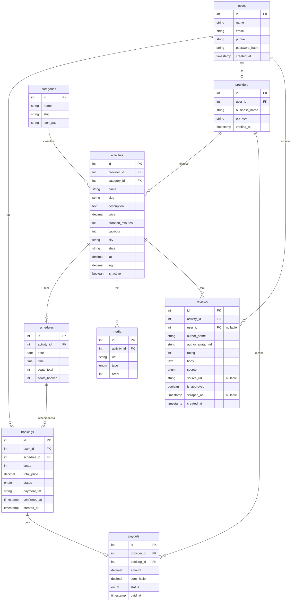

# Envago v2 — ER Diagram

## Notas de design

- `users` serve tanto turistas quanto operadores — se for operador, tem uma linha em `providers`
- `schedules` controla o contador de vagas — `seats_booked` incrementa a cada reserva
- `bookings` aponta para `schedule` (não direto para `activity`) para registrar data/horário exato
- `payouts` criado somente após operador confirmar (`bookings.status = confirmed`) — garante o fluxo PIX D+1
- `commission` salva na linha do payout para preservar histórico mesmo se a taxa mudar
- `reviews.user_id` é nullable — reviews raspadas do Apify não têm conta na plataforma; reviews de usuários sim
- `reviews.source` enum: `scraped` | `user_submitted`
- `reviews.is_approved` permite moderar antes de publicar (especialmente as raspadas)
- `reviews.source_url` guarda o link original (Google Maps, TripAdvisor etc.) para rastreabilidade
